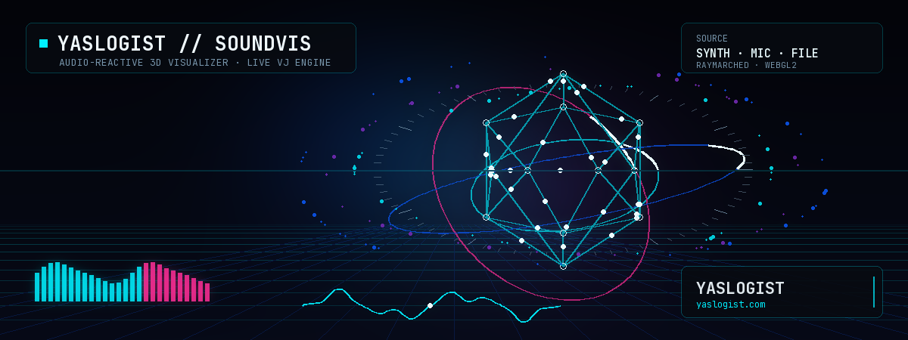
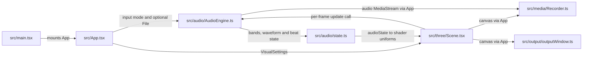

# YASLOGIST SOUNDVIS

A browser-based audio-reactive 3D visualizer with live VJ controls for techno sets.

<picture>
  <source media="(prefers-color-scheme: dark)" srcset="assets/readme/yaslogist-hero.png">
  
</picture>

*Existing brand artwork, not an application screenshot. [Asset renderer](assets/readme/build_readme_assets.py).*

The app connects Web Audio analysis to a Three.js scene, with a React control interface.
Choose a generated synth loop, a local audio file, a microphone or a shared audio source.

## Capabilities

| Capability | Maturity | Implementation |
| --- | --- | --- |
| Synth, file, microphone and shared-audio inputs | Implemented | [AudioEngine](src/audio/AudioEngine.ts) |
| FFT bands, waveform, beat detection and BPM estimation | Implemented | [AudioEngine](src/audio/AudioEngine.ts), [BPM](src/audio/bpm.ts) |
| Shader tunnel, core, particles, portal rings and post-processing | Implemented | [Scene](src/three/Scene.tsx), [shaders](src/three/shaders.ts) |
| Look slots, JSON import/export and URL sharing | Implemented | [Presets](src/presets/lookPresets.ts), [HUD](src/ui/Hud.tsx) |
| MIDI macros and pad controls | Implemented | [MidiManager](src/midi/MidiManager.ts) |
| PNG stills, video with source audio and projector mirror | Implemented | [Recorder](src/media/Recorder.ts), [output window](src/output/outputWindow.ts) |

## Run locally

Use Node.js and npm. The [CI workflow](.github/workflows/ci.yml) provides a reference environment;
no project-level Node.js engine requirement is declared in [package.json](package.json).

From the repository root:

```bash
npm ci
npm run dev
```

Open the address printed by Vite. The [development configuration](vite.config.ts) binds to all network
interfaces and permits the `.e2b.app` preview domain; it does not set an explicit port.

At the boot screen, choose **ENTER THE VOID ▸** to use the built-in generator.
For a local track, drag an audio file onto the page or use the file control.
Microphone capture needs browser permission and HTTPS; shared-audio capture needs an audio track
in the browser's screen/tab-sharing selection. Microphone and shared-audio monitoring are muted
in the app to prevent feedback. See [source acquisition](src/audio/AudioEngine.ts).

### Development checks

These commands are defined in [package.json](package.json) and invoked by [CI](.github/workflows/ci.yml):

```bash
npm run typecheck
npm run lint
npm run format:check
npm test
npm run build
```

[Vitest configuration](vitest.config.ts) selects TypeScript test files under `src/` in a Node environment.
The unit tests exercise BPM math, settings sanitization/storage, preset transport, MIDI maps/scaling
and safety-limit helpers. They do not establish browser, GPU or hardware compatibility.

## Structure and data flow

*How do input selection and audio analysis reach the visuals and capture outputs?*



[AudioDriver](src/three/Scene.tsx) calls the audio engine from the frame loop.
The engine writes analysis into shared `audioState`; scene components read it into material uniforms
and geometry updates. [App](src/App.tsx) passes the exposed canvas to capture and output utilities.
The projector window mirrors a canvas stream into a video element rather than rendering another scene.

<details>
<summary>Module guide and controls</summary>

| Path | Responsibility |
| --- | --- |
| [src/main.tsx](src/main.tsx), [src/App.tsx](src/App.tsx) | Mounting, boot, input selection and keyboard handlers |
| [src/audio/](src/audio/) | Audio graph, generator, BPM math and settings |
| [src/three/](src/three/) | Scene layers, GLSL and selected safety limits |
| [src/ui/Hud.tsx](src/ui/Hud.tsx) | Settings dock, preset file controls and sharing |
| [src/presets/](src/presets/) | Look extraction, validation and local bank |
| [src/midi/](src/midi/) | Web MIDI input handling |
| [src/media/](src/media/), [src/output/](src/output/) | Downloads, recording and projector mirroring |
| [src/ui/faultBus.ts](src/ui/faultBus.ts), [ErrorBoundary](src/ui/ErrorBoundary.tsx) | Fault routing and recovery interface |

Keyboard handlers are in [App](src/App.tsx):

- `Space`: toggle synth or file playback; `H`: toggle the HUD; `F`: toggle fullscreen.
- `P`: save a PNG; `R`: start/stop recording; `O`: toggle the projector window.
- `F1`–`F8`: recall a look; `Shift` + `F1`–`F8`: store one.
- `1`–`9` and `0`: select the first ten palettes; `G`: toggle glitch; `S`: toggle SAFE mode.
- `A`: toggle the performance governor; `L`: toggle Auto-Look; `Z`: toggle Zen mode.
- Left/right arrows: seek a file backward/forward; `?`: open help; `Escape`: close help.

The [MIDI map](src/midi/MidiManager.ts) assigns CC 20–27 to bloom, crystalline glitch, speed,
intensity, trails, particle size, core size and sensitivity. Notes 36–39 select palette/Zen/SAFE
actions; notes 40–47 recall look slots. Enable MIDI through the HUD; browser access may be refused.

</details>

## Build and distribution

```bash
npm run build
npm run preview
```

The build script runs TypeScript checking before Vite. [Vite configuration](vite.config.ts) enables
`vite-plugin-singlefile`; [CI](.github/workflows/ci.yml) uploads `dist/index.html` as the distribution
artifact. The preview command serves the production build locally.

Fonts are [bundled locally](src/index.css). The HTML shell also references Open Graph images in
[public/](public/); retain those assets when hosting the page if you need its social-preview metadata.
No deployment workflow or hosting-specific configuration is committed in this repository.

## Status and limitations

- **Implemented:** the [performance governor](src/three/Scene.tsx) adjusts pixel ratio and particle
  draw range in response to measured frame rate. This is adaptation, not a frame-rate guarantee.
- **Partial — SAFE mode:** [scene code](src/three/Scene.tsx) applies [helpers](src/three/safety.ts)
  to the background strobe rate, drop flash and camera punch, and suppresses automatic glitch bursts.
  This covers selected effects, not a verified photosensitivity guarantee. The
  [default settings](src/audio/state.ts) leave SAFE mode off and strobes on.
- **Browser-dependent:** [system capture](src/audio/AudioEngine.ts) fails if no audio track is shared;
  local file playback depends on the browser's decoder. [Recording](src/media/Recorder.ts) requires
  `MediaRecorder` and canvas streaming, and selects a supported WebM or MP4 MIME type.
  [Projector output](src/output/outputWindow.ts) requires canvas streaming and an allowed popup;
  [MIDI](src/midi/MidiManager.ts) requires Web MIDI access.
- **Unverified here:** application behavior, browser/hardware support, production output and current
  CI results. This README was rebuilt by reading source and configuration, without executing the app.

## Security and privacy

Local audio files are loaded through object URLs in [AudioEngine](src/audio/AudioEngine.ts), and
recordings are downloaded through browser-created blobs in [Recorder](src/media/Recorder.ts).
Settings and the look bank use `localStorage`; look-sharing URLs encode aesthetic settings in the
`#look=` fragment. See [settings storage](src/audio/state.ts) and [preset transport](src/presets/lookPresets.ts).

Persisted settings and imported looks pass through `sanitizeSettings()`, which clamps numeric ranges,
filters unknown fields and falls back to defaults for invalid values. MIDI CC values are scaled
using those ranges; they do not pass through the full settings sanitizer.
These mechanisms do not constitute a security audit. See [settings validation](src/audio/state.ts),
[preset validation](src/presets/lookPresets.ts) and [MIDI scaling](src/midi/MidiManager.ts).

## Contributing

Use the development checks above when preparing changes. The repository's
[CI workflow](.github/workflows/ci.yml) runs them for pushes and pull requests.

## License and attribution

[package.json](package.json) declares MIT and names Ahmed Yasser (YASLOGIST) as author.
There is no root `LICENSE` file in the tracked tree; the manifest declaration is not a substitute
for the missing license text.

The bundled JetBrains Mono fonts credit the JetBrains Mono Project Authors and include the
[SIL Open Font License](src/assets/fonts/OFL.txt).

Project attribution: [YASLOGIST](https://www.yaslogist.com).
